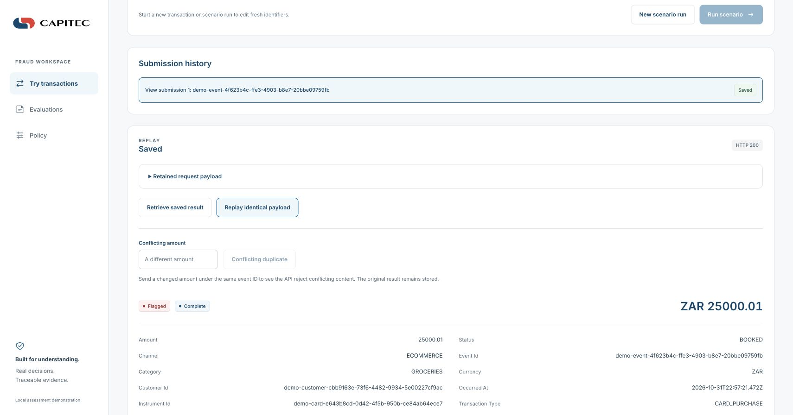
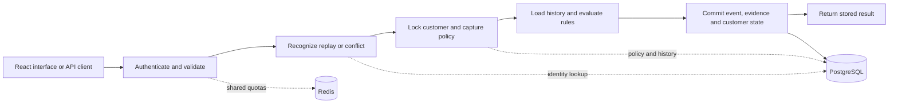

# Fraud Rule Engine engineering case study

**Java 21 · Spring Boot · PostgreSQL · Redis · React · TypeScript · Docker**

I built a configurable evaluation service and a companion interface for inspecting transaction decisions. The interesting problem was keeping the recorded transaction, rule evidence and policy version consistent when requests race, a dependency fails or a response is lost.

This project began as a technical assessment. The companion UI uses assets supplied for that assessment. It is a local engineering demonstration with synthetic data and illustrative thresholds; it is not a production banking system or an official bank product.

## Interface walkthrough

An identical replay returns the original ZAR 25000.01 evaluation. A changed amount under the same event ID is rejected: [conflicting duplicate screenshot](images/case-study/fraud-conflict.png).

These are captures of the local assessment demo using synthetic data on 1 November 2026. The supplied assessment branding identifies the demo context; it does not imply an official bank product. Screenshots illustrate the workflow and do not establish compatibility with a later backend build.

## The problem and what I built

The service evaluates **BOOKED outgoing card purchases and ATM withdrawals** against five rules: high amount, transaction velocity, cumulative spend, impossible travel, and small payments followed by a large payment. It flags observations for review; it does not authorize payments, reverse them or maintain a settlement ledger.

My implementation covers the Java API, rule engine, database migrations, protected access, live policy configuration and operational verification. I also built the React/TypeScript interface for transaction scenarios, saved evaluations and optional policy administration. The interface displays API results rather than calculating its own decisions.

The [service architecture](ARCHITECTURE.md) explains the complete flow, permission boundaries and data model. The [UI architecture](https://github.com/SibusisoMashita/fraud-rule-engine-ui/blob/main/docs/ARCHITECTURE.md) covers exact decimals, credentials and recovery in the browser.

## Three decisions that shaped the implementation

### 1. Save a complete evaluation in one transaction

A separate Spring bean owns the database transaction. It locks the scoped customer row, captures the preceding history sequence and stores the event, evaluation, rule results and updated customer state together. Deferred constraints and runtime database grants reinforce the application boundary.

The customer lock orders that customer's observed history across app instances. Different customers can proceed concurrently. This deliberately leaves a hot customer serial; adding replicas does not remove that limit. `READ COMMITTED` isolation alone would not provide the same ordering.

**Inspect:** [transaction boundary](../src/main/java/za/co/sibusiso/fraud/evaluation/application/TransactionalEvaluation.java) · [independent-connection integration tests](../src/test/java/za/co/sibusiso/fraud/TransactionalEvaluationTest.java).

### 2. Treat replay and uncertain outcomes as part of the contract

The producer supplies an event ID within its scope. Canonical request hashing recognizes equivalent payloads, including equivalent supported decimal and time representations. A new event returns **201**; an identical replay returns **200** with the original result; changed content under that ID returns **409**.

A timeout cannot establish whether a write committed. The service and UI preserve that uncertainty and avoid automatic write retries. The caller can retrieve the scoped ID or replay the retained payload. Retrieval confirms a visible stored event; identical replay also checks that its payload matches. A temporary 404 does not prove non-commit while the original write is still running.

This provides one committed evaluation per retained scoped event ID under the documented producer, database and locking assumptions. It cannot identify the same payment submitted with two different IDs.

**Inspect:** [submission coordinator](../src/main/java/za/co/sibusiso/fraud/evaluation/application/TransactionService.java) · [recovery drills](../scripts/verification/recovery.py) · [UI recovery contract](https://github.com/SibusisoMashita/fraud-rule-engine-ui/blob/main/docs/ARCHITECTURE.md#submission-and-recovery).

### 3. Change policy without changing the explanation of an old decision

PostgreSQL stores immutable policy versions and an active reference. Each evaluation captures one prepared version for eligibility checks, history planning and rule execution. A business-policy change needs no service restart; saved results and identical replays retain their original policy hash, evaluator build ID and rule evidence.

The optional administrator API adds validation, change review and revision-guarded activation. Concurrent edits return a conflict rather than silently overwriting a newer activation. Administration uses a separate credential and is disabled in the ordinary quickstart.

**Inspect:** [active policy provider](../src/main/java/za/co/sibusiso/fraud/policy/ActivePolicyProvider.java) · [policy API integration tests](../src/test/java/za/co/sibusiso/fraud/PolicyManagementApiTest.java).

## A short walkthrough

Use a local demo database and synthetic transactions. Keep API keys and credentials out of screenshots.

1. **Create and inspect a decision.** Start the backend with the [quickstart](../README.md#quickstart), then start the [companion UI](https://github.com/SibusisoMashita/fraud-rule-engine-ui#run-with-docker) and connect with the local ordinary key. Open **Try transactions**, choose the high-amount scenario, review its payload and submit. Inspect the rule evidence, policy hash and raw response. The active policy determines the result.
2. **Replay and challenge identity.** Select that submission and replay its retained payload. Expect the original saved result. Use the different-amount action under the same event ID to demonstrate the conflict response. Open **Evaluations** to retrieve the committed evidence independently of the playground journal.
3. **Show a policy change without rewriting history.** In the backend folder, copy `config/policy.example.yaml` to `secrets/case-study-policy.yaml`, edit the high-amount ZAR threshold and run `./scripts/activate-policy.sh secrets/case-study-policy.yaml`. Refresh the UI policy view and start **New scenario run**, using fresh IDs. Compare its policy hash with the earlier saved evaluation, then replay the original payload again. Its saved policy and result remain unchanged. Restore the sample policy with `./scripts/activate-policy.sh config/policy.example.yaml` when finished.

Use the sample policy as the starting point for step 3. On an existing customized database, make and restore your own policy copy instead. For a repeatable UI test environment, follow the [pinned-backend verification instructions](https://github.com/SibusisoMashita/fraud-rule-engine-ui#develop-and-test); ordinary startup uses whichever backend checkout you run.

## Where the evidence lives

| Question | Evidence |
| --- | --- |
| Does the transaction boundary commit or roll back completely? | [TransactionalEvaluationTest](../src/test/java/za/co/sibusiso/fraud/TransactionalEvaluationTest.java), including real PostgreSQL observations outside the writer connection |
| Can a response disappear after a write? | [Recovery verifier](../scripts/verification/recovery.py), plus the documented process-kill and lost-acknowledgement scenarios in [Testing](TESTING.md) |
| Can policy change while old results remain explainable? | [PolicyManagementApiTest](../src/test/java/za/co/sibusiso/fraud/PolicyManagementApiTest.java), transaction tests and the UI's real-Docker checks |
| Can a reviewer build and run it? | [Backend quickstart](../README.md#quickstart), [UI quickstart](https://github.com/SibusisoMashita/fraud-rule-engine-ui#run-with-docker), [backend CI](https://github.com/SibusisoMashita/fraud-rule-engine-service/actions/workflows/verify.yaml) and [UI CI](https://github.com/SibusisoMashita/fraud-rule-engine-ui/actions/workflows/verify.yaml) |

CI results apply to their recorded commits and workloads. The UI's [contract metadata](https://github.com/SibusisoMashita/fraud-rule-engine-ui/blob/main/api/source.json) identifies the backend revision used by its verifier. A passing pinned run does not establish compatibility with every later backend revision. [Testing](TESTING.md) separates measured local capacity results from functional checks and records the remaining limits.

## Current boundaries

This demonstration does not establish production availability, fraud-detection accuracy or business impact. Rules need calibrated thresholds, trustworthy producer data and human review. Deployment with real data would also need a threat model, TLS and identity controls, privacy and retention decisions, monitoring, capacity targets and reviewed backup/reconciliation procedures.

History records what the engine had observed at evaluation time. Delayed events do not rewrite earlier decisions, and pagination is a live traversal rather than a snapshot. Managed production autoscaling, arbitrary rolling-version compatibility and production recovery objectives remain separate work. The implemented Docker scaling demo is local evidence only.
