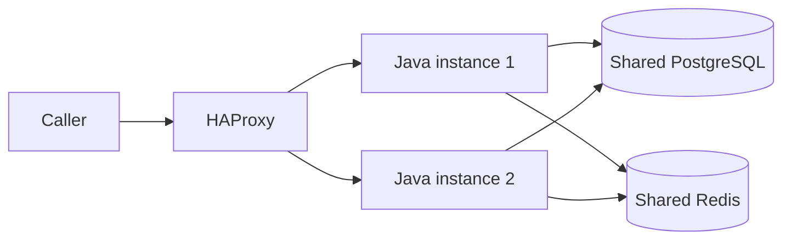

# How scaling works

Think of app instances as cashiers sharing the same bank records. HAProxy sends each caller to a ready cashier. The Docker demo watches successful traffic and adds or removes a cashier within configured limits.

## The building blocks



PostgreSQL stores transactions, evaluations, identities and business policy. Redis shares caller quotas. Every ready instance can handle a request; they share the cursor-signing key too. Database duplicate protection saves one evaluation for identical retries, and a customer lock orders that customer's history across instances. Different customers can run in parallel.

Adding an instance does not change caller quotas or fraud thresholds. Activating business policy changes the next evaluation without restarting any instance. Infrastructure settings still require coordinated configuration and restarts.

## Readiness-aware routing

The optional [Compose overlay](../compose.balanced.yaml) places HAProxy in front of the apps and removes their host ports. PostgreSQL and Redis stay internal. Docker DNS discovers replicas. Every new backend starts down and must pass `/health/ready` before receiving traffic. Failed checks remove it from new routing; successful checks allow it back. `/health/live` alone does not admit traffic. Operators still decide whether to approve a release.

The [proxy configuration](../docker/haproxy.cfg) defines round-robin routing, connection/queue bounds, header/body deadlines, body limits and health/DNS intervals. Coordinate body limits with [service settings](../config/service.example.yaml). Forwarding headers are stripped; they cannot supply identity or scope. App permissions and Redis quotas still apply.

Automatic upstream retries are disabled: a lost response may follow a committed payment. Callers retrieve or replay the same event ID and payload.

For a persistent two-instance setup, first build the image and initialize secrets as described in the [README](../README.md). Then run:

```sh
docker compose -f compose.yaml -f compose.balanced.yaml up -d --no-build --wait --wait-timeout 120 --scale app=2
curl --fail http://localhost:8080/health/ready
```

Stop that setup with:

```sh
docker compose -f compose.yaml -f compose.balanced.yaml down
```

This overlay needs Compose 2.24.4+. `BALANCER_PORT` changes the loopback port. `FRAUD_MAX_REPLICAS` sets available backend slots (default two); review the connection/resource budget before increasing it. For an old PostgreSQL data directory, follow the [migration runbook](OPERATIONS.md#database-image-migration) first.

`FRAUD_DEMO_HEADERS` defaults to false. The disposable demo enables `X-Demo-Backend` so you can see which ready instance handled a request. Its admin listener stays on container loopback, accessed through Docker exec, with no published port. HAProxy mounts neither app credentials nor the Docker socket.

## Demonstrating automatic scaling on Docker

Build the image using the README, then run:

```sh
python3 -B scripts/demo-scaling.py
```

The script creates its own Docker project and prints the project name and URL. Select that project in Docker Desktop. The console shows successful requests per second, running/ready instances and each backend's request count. During the busy phase, `curl --include <printed-url>/health/ready` also shows `X-Demo-Backend` changing between ready replicas.

Sustained successful traffic triggers scale-out. Compose starts another app, which receives traffic only after it becomes ready. Sustained low traffic in the quiet phase triggers scale-in. The controller drains the highest-numbered replica, waits for active requests and its queue to empty, then stops/removes that exact container. A later scale-out makes the vacant slot eligible for readiness checks again.

At the end, the script prints the observed replica changes and request distribution, saves a report under `target/scaling/`, and removes its resources. Ctrl-C also cleans up. Your existing development project is left alone.

[Demo settings](../config/scaling-demo.example.json) control replica bounds, request-rate target, sample counts, cooldown, polling, traffic phases and drain time. Defaults send eight reads/second, target four successes/second per replica and demonstrate **one → two → one**. These small values make scaling easy to watch; they are not production capacity limits.

The controller reads actual HAProxy success counters. Consecutive samples and cooldown prevent rapid oscillation. Missing/reset counters, invalid measurements or incomplete readiness hold the replica count. Failed control/metrics commands stop the demo and clean up. Failed requests do not inflate demand, though successful public routes contribute to this simple signal. Production needs secured app metrics and a measured scaling target.

Before startup, the demo checks the verification connection budget, rollout allowance and app pool against:

```text
(maximum instances + rollout surge) × pool limit ≤ database application connection budget
```

CPU, memory and host capacity also limit growth. Extra apps cannot fix a saturated database or parallelize one customer's locked history. PostgreSQL and Redis remain single shared services locally; app replication does not make them highly available.

## Verification and production autoscaling

Run the extended checks with:

```sh
python3 -B scripts/demo-scaling.py --verify
```

They cover routing, auth/roles, shared quotas, duplicate safety, live policy on both instances, unavailable and unready backends, no-ready 503s, recovery, body bounds and writes during drained scale-in. The automatic demo then checks actual scale-out, scale-in and traffic on both backends. Failed checks stay failed in the report. [Testing](TESTING.md) records results and limits; [Operations](OPERATIONS.md#operational-verification) covers the wider operational checks. The earlier direct-instance benchmark does not establish maximum throughput through HAProxy.

The Docker controller is demo tooling with host Docker access. Managed production autoscaling remains [stage 12](DELIVERY_PLAN.md#future-autoscaling-change): select a platform, secure metrics, provide host capacity, handle failures and measure targets. For example, [Kubernetes HPA](https://kubernetes.io/docs/concepts/workloads/autoscaling/horizontal-pod-autoscale/) adjusts Deployments using resource/custom metrics; CPU utilization needs resource requests and a metrics provider. The local demo does not qualify a Kubernetes or cloud deployment.
