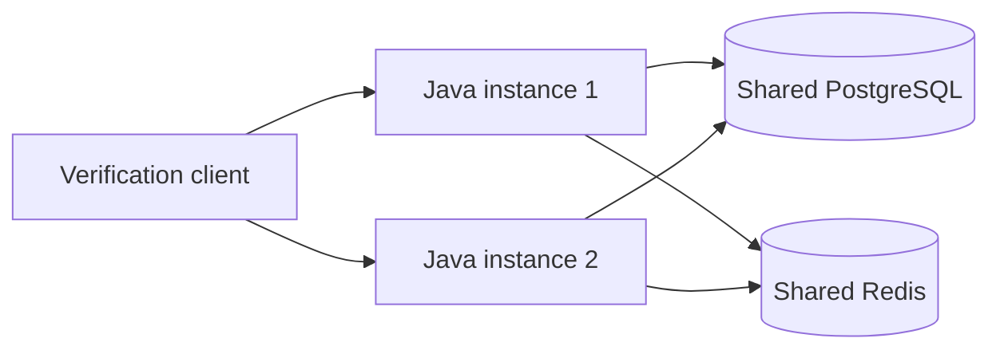

# How scaling works

Think of the application instances as cashiers sharing the same bank records. Adding another cashier lets different customers be served at the same time. It does not create another set of records.

**Current status:** the service has been tested with one and two application instances. The verification harness sends requests directly to alternating instances. The default local Compose setup runs one instance. A load balancer is planned in [delivery stage 11](DELIVERY_PLAN.md#planned-load-balancer-change); it is not implemented yet.

## The current building blocks



Each instance runs the same Java application. PostgreSQL holds transactions, evaluations, identities and versioned business policy. Redis holds shared rate-limit counters. Requests can reach either instance without needing a login session or customer history stored in that instance's memory. Instances use the same cursor-signing secret so a query can continue on another instance.

| Building block | Why it matters |
| --- | --- |
| Shared PostgreSQL | Both instances read authoritative history and store results in one place. |
| Live database policy | Each evaluation captures one complete active policy version. New selections see activated changes without restarting either instance. |
| Shared Redis quotas | A caller cannot gain a second allowance by switching instances. |
| Database duplicate protection | Concurrent copies of the same scoped event produce one committed evaluation; identical retries return its original result. |
| Per-customer database lock | Accepted evaluations for one scoped customer are serialized across instances so receipt-history rules see consistent state. Different customers can run in parallel. |
| Per-instance resource limits | CPU, memory, active requests and database connections are bounded. Busy instances reject excess work rather than accepting unlimited work. |

Business rules stay inside the Java service and its database policy. Adding an instance requires no rule changes. Authentication and authorization still apply to every protected request.

## What adding an instance changes

With one instance, every request goes through that instance. With two, requests from different customers can be handled at the same time across both instances. This is horizontal scaling: adding copies of the application.

Both copies still share PostgreSQL and Redis. Extra instances also create extra database connections. The total connection allowance must include every instance and temporary instances used during a rollout:

```text
(instances + rollout surge) × pool limit per instance ≤ database application connection budget
```

The pool limit comes from [startup service configuration](../config/service.example.yaml). Resource limits come from [Compose](../compose.yaml). These infrastructure settings require coordinated restarts; fraud thresholds, windows and enabled states change through live database policy.

More copies do not guarantee proportionally more throughput. A busy database can remain the bottleneck, and one hot customer still shares one serialization lock. PostgreSQL and Redis are single shared services in the local setup; application replication alone does not make those dependencies highly available. [Architecture](ARCHITECTURE.md#7-capacity-and-deferred-alternatives) records the connection-budget and consistency trade-offs.

## What the load balancer will add

A load balancer provides one address for callers and chooses a ready application instance for each request.

```text
Caller → load balancer → ready Java instance → shared PostgreSQL / Redis
```

The planned change routes new requests away from unavailable or unready instances and drains traffic during shutdown. Readiness is a technical health signal; deployment release checks must pass before opening traffic. The proxy will have configured timeouts and request limits. It will not automatically retry transaction POSTs: a lost response may follow a successful commit, so recovery retrieves or replays the same event ID and payload.

A load balancer distributes traffic among running instances. An autoscaler decides when to start or stop instances. Stage 11 adds load balancing with a fixed two-instance setup; autoscaling remains deployment work. There are no load-balancer run commands yet because the component has not been implemented.

## How we would add autoscaling

Think of an autoscaler as the supervisor watching the cashiers. When sustained demand grows, it opens another till. When demand stays low, it closes a till after the cashier finishes serving the current customer. The load balancer directs callers to the cashiers who are ready.

**Status:** this is a future deployment design, after stage 11. There is no autoscaler or autoscaling configuration in the repository today.

```text
Metrics → autoscaler → desired number of Java instances
                            ↓
Caller → load balancer → ready instances → shared PostgreSQL / Redis
```

The implementation would follow these steps:

1. **Choose the deployment platform.** Use its managed autoscaler rather than adding a scaling loop to Java. For example, Kubernetes could run the application in a Deployment with a Service and an ingress/gateway, and a Horizontal Pod Autoscaler (HPA) could change the replica count. CPU utilization requires CPU requests and a metrics provider; custom signals require the appropriate metrics adapter. See the official [HPA documentation](https://kubernetes.io/docs/concepts/workloads/autoscaling/horizontal-pod-autoscale/).
2. **Measure useful demand.** Add application measurements for active requests, request latency, capacity rejections, database pool waits and lock waits. Combine them with CPU and dependency health to establish a tested scaling signal. CPU alone can miss database-bound work; latency or 429 responses alone can reflect a hot customer or an intentional quota, neither of which is solved by more instances.
3. **Configure safe bounds.** Keep minimum/maximum instances, utilization targets, evaluation windows, stabilization periods and scaling rates in versioned deployment configuration. Derive maximum instances from the database connection budget above, including rollout surge, and the available host resources. Values must come from workload measurements; there are no recommended production numbers yet. These are infrastructure controls, separate from live fraud policy.
4. **Join and leave safely.** New instances receive the same approved image, startup settings and secrets, then join routing only after startup/readiness checks pass. Scaling does not rerun migrations or policy seeding in every application instance. Removal stops new routing and allows in-flight work to drain within the configured shutdown budgets. Platform termination/routing behaviour must be verified; see [Pod termination](https://kubernetes.io/docs/concepts/workloads/pods/pod-lifecycle/#pod-termination).
5. **Prove the control loop.** Offer a measured workload through the load balancer, observe scale-out and readiness, then reduce demand and verify stable scale-in and graceful completion. Check duplicate safety, complete evaluations, shared quotas, consistent policy and the connection ceiling throughout. Exercise missing metrics, dependency outages, maximum capacity and rejected work; sustained failures must alert operators rather than cause unlimited growth.

The autoscaler changes the number of application instances. It does not raise a caller's quota, change fraud thresholds, make a hot customer's transactions parallel, or increase database capacity. Host capacity must also exist for new instances; adding hosts is a separate infrastructure concern. Shared PostgreSQL/Redis availability and recovery still require their own deployment design.

This would be [stage 12](DELIVERY_PLAN.md#future-autoscaling-change), an optional separate deployment change. Stage 11 will remain independently runnable and testable without enabling autoscaling. Until the control loop is implemented and measured, the service has multi-instance evidence, not autoscaling evidence.

## What we have proved

The documented local workload passed with one instance and with two: each handled 20 requests per second for five minutes under the tested configuration. Multi-instance checks also cover shared quotas, duplicate races, history rules, live policy changes and signed pagination. This demonstrates correctness across instances and the stated workload; it does not establish double throughput, maximum capacity, production load balancing or automatic scaling.

[Testing](TESTING.md#local-qualification) owns the measured results and their limits. [Operations](OPERATIONS.md#operational-verification) owns the commands and evidence locations. Stage 11 will add tests through the single proxy entrypoint before load-balanced behaviour is described as verified.
